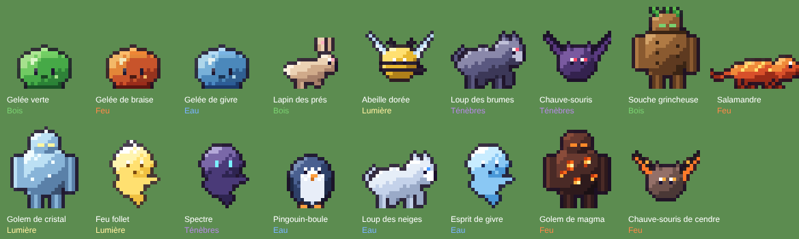

# Pixels Worlds — bestiaire, éléments et butin

Statut : **codé**. Monstres dessinés dans `client/assets.js` (`bestiary()`), règles dans `client/core.js` (`MOBDEF`, `ELEMENTS`, `LOOT`).

## Éléments et traits

| Élément | Couleur | Trait en combat |
|---|---|---|
| Feu | orange | ses coups **brûlent** le héros 3 s ; insensible aux brûlures |
| Eau | bleu | ses coups **ralentissent** le héros 2 s ; insensible au gel de l'Île Givrée |
| Bois | vert | **se régénère** (2 % des PV par seconde) quand on ne le frappe pas |
| Lumière | jaune pâle | **encaisse 20 % de dégâts en moins** |
| Ténèbres | violet | **draine** : récupère 30 % des dégâts qu'il inflige |

Un petit carré de la couleur de l'élément s'affiche devant le nom du monstre ciblé.

## Où les trouver

| Lieu | Monstres |
|---|---|
| Prairies de Lumen | Gelée verte, Lapin des prés, Abeille dorée |
| Bois des Champis | Champi des bois, Loup des brumes, Chauve-souris, Souche grincheuse |
| Terres sauvages | Gelée de braise, Salamandre, Golem de cristal (élite), Spectre, Feu follet ; Roi Gelée (boss) |
| Île Givrée | Gelée de givre, Pingouin-boule, Loup des neiges, Esprit de givre (+ champis, gelées vertes) |
| Île des Braises | Gelée de braise, Salamandre, Golem de magma (élite), Chauve-souris de cendre (+ champis, gelées vertes) |
| Île de Brume | Feu follet, Spectre, Loup des brumes, Chauve-souris, Souche, et d'autres |

## Butin

- Un objet tombe rarement : ≈ 3 % par monstre (5 % sur les golems), dans la liste propre à chaque monstre ;
  le Roi Gelée donne toujours un objet rare ou mieux.
- Rareté : commun 78 %, inhabituel 17,5 %, rare 3,9 %, épique 0,6 %.
- 22 nouveaux objets liés aux monstres : Capuche de lapin, Dard doré, Pelisse et Croc de loup, Ailes de nuit, Écorce vive,
  Bâton de souche, Écailles et Bottes de salamandre, Cœur et Espadon de cristal, Lanterne du follet, Voile du spectre,
  Grimoire des ombres, Bonnet de pingouin, Fourrure des neiges, Lance de glace, Grimoire de givre, Plastron et Hache de magma,
  Ailes et Jambières de cendre.

## Difficulté

Monstres : PV ×1,7 et attaque ×1,5 par rapport aux débuts, avec des écarts par espèce (golems robustes et lents, loups rapides…).
Mesures en simulation (6 monstres du même niveau, 2 à la fois, sans repos) :
- héros normal de niveau 8 : 13 à 18 s, 3 à 5 potions, 35 à 75 % de PV restants ; deux golems à la fois le tuent ;
- Archi404 en armure de Maître du jeu : 4 à 9 s, aucune potion, plus de 94 % de PV.
