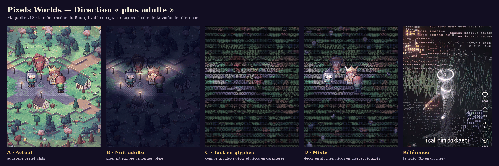

# Pixels Worlds — vers des graphismes plus adultes

Statut : **en jeu (étape 1)**. Choix d'Archibald (série 4) : **D · Mixte**, **partout**, personnages **plus élancés**
(étape 2, maquette d'abord), **cycle jour et nuit**, effets **pluie et brume, sorts en néon, lueur, glitch**, on garde **notre monde**.

## Étape 1 (codée)

- Décor en glyphes : `client/game/atmo.js` peint le décor fixe d'une île une seule fois (`buildGlyphDecor`), le convertit en
  glyphes de 3 × 5 pixels sur des cases de 4 × 6, et chaque image le recopie. Personnages, monstres, PNJ, ressources, coffres,
  portails, torches et lanternes restent en pixel art par-dessus, avec une lueur (`charGlow`). Plus rapide que l'ancien rendu
  (mesure, processeur ralenti ×4 : 27 images/s contre 15). `localStorage.etheria_glyph = '0'` revient à l'ancien rendu.
- Jour et nuit : une journée = 20 minutes réelles, la même pour tous (`dayLight`, `nightK`) ; la nuit, l'obscurité laisse un
  cercle de lumière autour du héros et les lanternes brillent ; teinte orangée à l'aube et au crépuscule.
- Météo : pluie et brume environ 4 minutes sur 10 (`rainK`), jamais dans les donjons.
- Sorts en néon (anneaux, étincelles et projectiles additionnés à la lumière), éclair rouge en croix et « glitch » de l'écran
  sur tes coups critiques (`critFx`).

Point de départ : une vidéo envoyée par Archibald. Une scène 3D de nuit, dessinée en caractères de texte (glyphes), sous la
pluie, avec des néons rouges et verts. Le décor est la Corée de l'époque Joseon (un dokkaebi coiffé d'un chapeau gat), et
les silhouettes sont réalistes.

La même scène du Bourg, traitée de quatre façons à partir d'une vraie capture du jeu :

- **A · Actuel** : aquarelle pastel, personnages chibi.
- **B · Nuit adulte** : pixel art désaturé et sombre, lumière des lanternes, pluie.
- **C · Tout en glyphes** : chaque case de l'écran devient un caractère coloré, décor et héros compris, comme la vidéo.
- **D · Mixte** : décor en glyphes, héros et monstres en pixel art éclairés, avec une lueur autour d'eux.

Ce qu'il faudrait pour C ou D en jeu : un rendu « glyphes » calculé à chaque image sur une grille de caractères
(par exemple 6 × 10 pixels), à mesurer sur iPhone, et la règle actuelle « jamais d'effet plein écran par image » à revoir.
Des proportions plus élancées obligent à redessiner toutes les grilles de `sprites.js`.

Questions posées : direction, où l'appliquer, proportions des personnages, moment de la journée, effets, univers.
