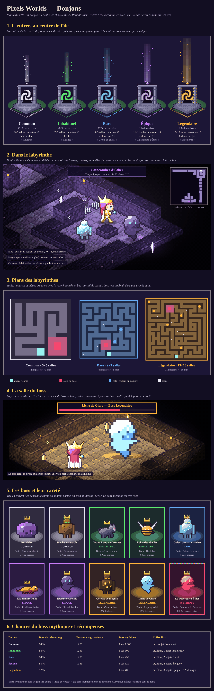
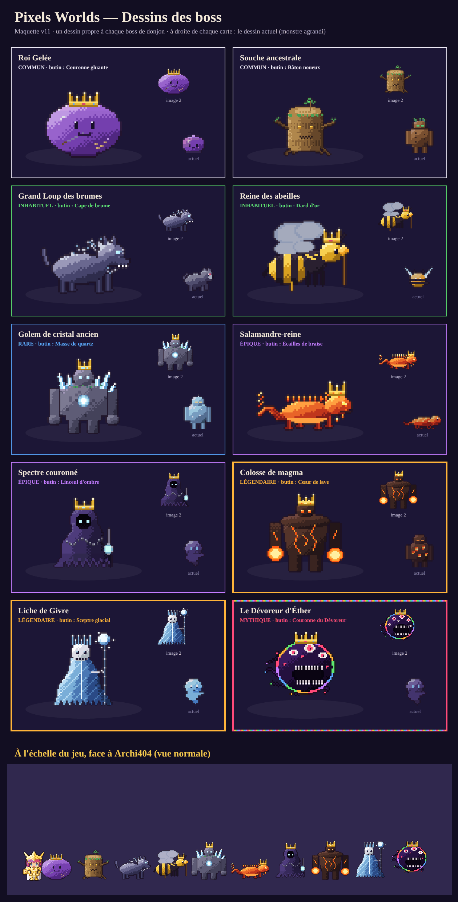

# Pixels Worlds — donjons au centre des îles

Statut : **codé** (v1 : les boss utilisent les dessins du bestiaire, agrandis et couronnés ; leurs propres dessins viendront ensuite).

Choix d'Archibald :
- un donjon au centre des îles du Pont d'Éther : Givrée, Braises et îles éphémères, mais pas l'île de départ ;
- la rareté est tirée à chaque arrivée sur l'île ;
- mêmes règles que sur les îles : PvP, et la mort fait perdre le sac (pillable 3 min) ;
- en fin de donjon : coffre final, butin propre au boss, titre.

Maquette : `prototype/maquette-donjons.html`, dessinée avec l'art du jeu (héros, monstres, couronne).
Les boss y sont de grandes versions couronnées des monstres du bestiaire ; en jeu, chaque boss aura son propre dessin.

## L'entrée

- Au **centre de l'île** : un portique de pierre sur une plateforme, un escalier qui descend dans un tourbillon.
- **La couleur dit la rareté** (le même code que les objets) :
  - un **faisceau de lumière** visible de loin, d'autant plus haut que le donjon est rare ;
  - des runes et une gemme sur les piliers, avec des garnitures dorées au rang Légendaire ;
  - une **icône colorée** sur la mini-carte.
- On approche : « Entrer dans le donjon Épique — Catacombes d'Éther ? ». L'entrée est gratuite.
- L'île est générée pour que l'entrée reste toujours accessible à pied depuis l'arrivée, comme le pont du retour.

## Raretés

| Rareté | Chance | Labyrinthe | Monstres | Élites | Pièges | Ambiance | Durée |
|---|---|---|---|---|---|---|---|
| Commun (blanc) | 55 % | 5×5 salles | niveau du héros | 0 | non | Caveau, pierre grise | ~3 min |
| Inhabituel (vert) | 25 % | 7×7 | +1 | 1 | non | Racines, mousse | ~5 min |
| Rare (bleu) | 12 % | 9×9 | +2 | 2 | oui | Grotte de cristal | ~8 min |
| Épique (violet) | 6 % | 11×11 | +3 | 4 | oui | Catacombes d'Éther | ~12 min |
| Légendaire (or) | 2 % | 13×13 | +5 | 6 | oui, plus nombreux | Salle dorée | ~18 min |

- **Plus rare = plus difficile** : un labyrinthe plus grand, avec moins de raccourcis et plus d'impasses ; des monstres de plus haut niveau ; plus d'élites ; des pièges ; et **plus sombre** (le rayon de lumière du héros rétrécit).
- **Élites** : aura de la couleur du donjon, PV ×3, butin assuré ; elles gardent les impasses les plus lointaines.
- **Pièges à pointes** : ils sortent par intervalles, il faut regarder le rythme.
- **Cristaux** de la couleur du donjon : ils éclairent les carrefours et pointent vers le boss.

## Le labyrinthe

- Un plan neuf à chaque donjon : grille de salles creusée par un parcours en profondeur, puis quelques murs ouverts pour créer des boucles. Le plan vient de la graine du donjon, comme les îles éphémères.
- Couloirs de 2 cases, murs d'une case. En 2.5D, les murs entre la caméra et le héros sont abaissés pour qu'on le voie toujours.
- **Mini-carte** propre au donjon, qui se révèle au fil de l'exploration.
- **Entrée = portail de sortie** : on peut ressortir à tout moment (le donjon est alors perdu pour cette arrivée).
- **Salle du boss** : la salle 2×2 la plus éloignée de l'entrée.
  - En entrant, la porte se scelle derrière soi, et la barre de vie du boss s'affiche, encadrée de sa rareté.
  - Une fois le boss vaincu : coffre final et portail de sortie vers le centre de l'île.

## Boss

- Le boss est tiré à l'entrée : **88 %** de la rareté du donjon, **12 %** un rang au-dessus (Légendaire : 97 % / 3 % mythique).
- Le boss **mythique**, le Dévoreur d'Éther, est extrêmement rare :
  - Commun : 1 sur 1 000 ;
  - Inhabituel : 1 sur 500 ;
  - Rare : 1 sur 250 ;
  - Épique : 1 sur 120 ;
  - Légendaire : 1 sur 40.
- Le boss a le niveau du donjon, avec environ 9 fois les PV d'un monstre (comme le Roi Gelée actuel) et ses propres attaques.

| Rareté | Boss | Butin propre |
|---|---|---|
| Commun | Roi Gelée, Souche ancestrale | Couronne gluante, Bâton noueux |
| Inhabituel | Grand Loup des brumes, Reine des abeilles | Cape de brume, Dard d'or |
| Rare | Golem de cristal ancien | Poings de quartz |
| Épique | Salamandre-reine, Spectre couronné | Écailles de braise, Linceul d'ombre |
| Légendaire | Colosse de magma, Liche de Givre | Cœur de lave, Sceptre glacial |
| Mythique | Le Dévoreur d'Éther | Couronne du Dévoreur (100 %, unique, visible sur le perso) |

Le butin propre au boss tombe à 5 % (Commun) et jusqu'à 12 % (Légendaire). Ce sont des objets dessinés pour le boss ;
ceux qui se portent sont visibles sur le personnage.

### Dessins propres (validés, en jeu)

Chaque boss a maintenant son dessin, à l'échelle d'un grand monstre (48 à 60 pixels), avec 2 images d'animation :
gelée royale avec un trésor englouti, vieux tronc sur ses racines, loup à crinière de brume, reine des abeilles avec son
sceptre de miel, golem aux cristaux et au cœur lumineux, salamandre à collerette de flammes, spectre à lanterne et
chaînes, colosse aux fissures de lave et aux poings en fusion, liche au crâne givré et à l'orbe gelée, et le Dévoreur
d'Éther : bouche du vide, six yeux, tentacules et liseré arc-en-ciel. Dessins : `assets.js` (`bossArt`, aussi pour le Roi Gelée du Bourg) ;
maquette : `prototype/maquette-boss.html`.

### En combat (validé dans le formulaire, série 2)

- **Présentation** : en entrant dans sa salle, le nom du boss et sa rareté s'affichent en grand pendant 2 s.
- **Attaque spéciale** (toutes les 7 à 10 s quand il a une cible) : annoncée par « Nom de l'attaque ! » et un cercle rouge
  au sol qui se remplit ; le boss reste immobile et tremble pendant l'annonce. Il suffit de sortir du cercle à temps.

| Boss | Attaque | Où | Effet |
|---|---|---|---|
| Roi Gelée | Saut écrasant | sous la cible | il atterrit dessus, dégâts ×1,6, ralentit |
| Souche ancestrale | Racines | sous la cible | dégâts ×1,2, presque immobile 1,5 s |
| Grand Loup des brumes | Bond | sous la cible | il bondit, dégâts ×1,5, saignement 4 s |
| Reine des abeilles | Essaim | sous la cible | dégâts ×0,8 puis 4 s de piqûres |
| Golem de cristal ancien | Éclats de cristal | autour de lui | dégâts ×1,4 |
| Salamandre-reine | Souffle de feu | sous la cible | dégâts ×1,3, brûlure 4 s |
| Spectre couronné | Chaînes | sous la cible | dégâts, ramène le héros contre lui |
| Colosse de magma | Frappe du sol | autour de lui | dégâts ×2, presque immobile 1,5 s |
| Liche de Givre | Gel de la salle | grand cercle autour d'elle | dégâts ×1,1, ralentit 3 s |
| Le Dévoreur d'Éther | Dévorer | très grand cercle | dégâts ×2, attire tout le monde |

Données : `DG_BOSSES[].sk` dans `content.js` ; moteur : `Sim.bossSkill` ; événements `bsk` (annonce) et `bskx` (déclenchement).

## Récompenses

- **Coffre final** :
  - Commun : or et 1 objet Commun ou mieux ;
  - Inhabituel : or, Éther et 1 objet Inhabituel ou mieux ;
  - Rare : or, Éther et 2 objets Rare ou mieux ;
  - Épique : or, Éther et 2 objets Épique ou mieux ;
  - Légendaire : or, Éther et 3 objets Épique ou mieux, avec 1 % de chances d'un objet Unique.
- **Titres**, affichés au-dessus du nom et visibles par les autres joueurs (choix dans la page personnage) :
  - vaincre un boss Légendaire donne « Fléau de <boss> » ;
  - le boss mythique donne le titre doré « Dévoreur d'Éther ».

## Règles

- **Danger** : comme sur les îles, PvP possible et sac perdu à la mort (corps pillable 3 min, objets uniques protégés).
  Après la mort, on réapparaît à l'entrée du donjon (le corps reste pillable là où l'on est tombé) ; les monstres vaincus ne reviennent pas.
- **Une fois par arrivée** : boss vaincu, l'entrée s'éteint jusqu'à la prochaine traversée du Pont d'Éther (nouveau tirage).
- **En ligne** : le serveur fait tourner une simulation par donjon (comme les îles éphémères). Les joueurs qui entrent dans le donjon d'une même île se retrouvent ensemble (coopération ou PvP). Le donjon est retiré quand son boss est vaincu et que tout le monde en est sorti.
- **Sauvegarde** (champs nouveaux, sans toucher aux anciens) :
  - `dg` : donjon de l'arrivée en cours (graine, rareté, boss vaincu ou non) ;
  - `ttl` : titres gagnés ;
  - `tt` : titre affiché.
  Le voyage vers le donjon reprend le mécanisme des îles (sauvegarde, brume, rechargement).

## Code

- `core.js` : `DG` (raretés), `DG_BOSSES`, `TITLES`, `rollDungeon`, `buildDungeon` (labyrinthe, élites, pièges, torches, cristaux),
  entrée `W.gate` posée au centre des îles par `buildIsle`, messages `dgIn` / `dgOut` / `tt`, événements `travel` (via `dg` / `dgout`), `ttl`, `dgdone`.
- Sauvegarde : `dg` (donjon de l'arrivée en cours, `done` quand il est fini ou abandonné), `ttl` (titres, bits), `tt` (titre affiché, -1 aucun) ;
  `arr: 2` = réapparaître devant l'entrée en sortant du donjon.
- `assets.js` : pierre par rareté (`DG_STONE`), torche, cristal, pointes, entrée (`dungeonArt`). `client/game/` : obscurité en bandes tramées (`darkness`),
  murs translucides devant le héros, faisceau de l'entrée, mini-carte révélée, barre du boss, titres.
- Serveur : une simulation par donjon (`donjon:<graine>`), libérée 5 min après le départ du dernier joueur ; `dgdone` éteint l'entrée de l'île.

## Choix retenus (validés par Archibald dans le formulaire de décisions)

1. Chances 55 / 25 / 12 / 6 / 2 % (choix d'Archibald : les rares restent vraiment rares) et labyrinthes de 5×5 à 13×13 salles.
2. Boss de la maquette, le Dévoreur d'Éther seul boss mythique.
3. Ressortir avant le boss : le donjon est perdu pour cette arrivée.
4. Titres : boss Légendaires et Mythique seulement.

## Donjons agrandis et sceaux (v15)

Validé par Archibald (formulaire) : donjons environ deux fois plus grands, sceaux à activer, plus de monstres et de pièges.

| Rareté | Salles | Sceaux | Élites (gardiens + autres) | Pièges | Salles occupées |
| --- | --- | --- | --- | --- | --- |
| Commun | 7 × 7 | 2 | 2 + 1 | 4 | 60 % |
| Inhabituel | 10 × 10 | 2 | 2 + 2 | 8 | 60 % |
| Rare | 13 × 13 | 3 | 3 + 4 | 14 | 55 % |
| Épique | 16 × 16 | 4 | 4 + 6 | 22 | 55 % |
| Légendaire | 20 × 20 | 5 | 5 + 9 | 32 | 50 % |

- La salle du boss est fermée par un rideau de lumière sur ses cases d'entrée (`W.dg.door`, `W.dg.shut`).
- Les sceaux sont dans les culs-de-sac lointains, choisis pour être éloignés les uns des autres et de la salle du boss ;
  chacun est gardé par un élite. Toucher un sceau dont le gardien est vaincu l'active ; tous activés = la salle s'ouvre.
- Le labyrinthe est relié pour que rien d'autre que la salle du boss ne soit coupé par sa fermeture.
- Affichage : stèle avec rune (pâle, puis à la couleur du donjon), compteur « Sceaux n / N » en haut, sceaux sur la mini-carte.
