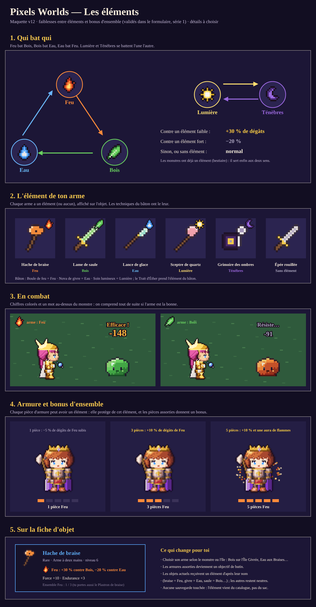

# Pixels Worlds — éléments : faiblesses et bonus d'ensemble

Statut : **maquette, détails à valider** (le principe est validé : formulaire, série 1).

Maquette : `prototype/maquette-elements.html`.

## Proposition

- **Cycle** : Feu bat Bois, Bois bat Eau, Eau bat Feu ; Lumière et Ténèbres se battent l'une l'autre.
- **Dégâts** : +30 % contre un élément faible, −20 % contre un élément fort, normal sinon ou sans élément.
  Les monstres ont déjà un élément (`MOBDEF.el`) : il sert désormais dans les deux sens.
- **Arme** : chaque arme a un élément ou aucun, donné par le catalogue (`ITEMS[].el`), donc sans toucher aux sauvegardes.
  Les objets actuels le reçoivent d'après leur nom (braise = Feu, givre / glace = Eau, saule / souche = Bois,
  quartz / cristal = Lumière, ombres / nuit = Ténèbres) ; les autres restent neutres.
- **Techniques du bâton** : Boule de feu = Feu, Nova de givre = Eau, Soin lumineux = Lumière ; le Trait d'Éther prend l'élément du bâton.
- **Armure** : chaque pièce d'un élément réduit de 5 % les dégâts de cet élément.
- **Bonus d'ensemble** : 3 pièces du même élément = +10 % de dégâts de cet élément ; 5 pièces = en plus une aura colorée.
- **Lisibilité** : icône d'élément sur les objets et à côté du nom des monstres, chiffres colorés, « Efficace ! » / « Résiste… ».

## À valider (formulaire, série 3)

Valeurs, façon dont les armes reçoivent leur élément, protection des armures, objets actuels, affichage.
