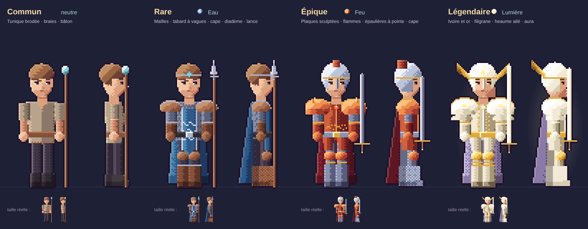
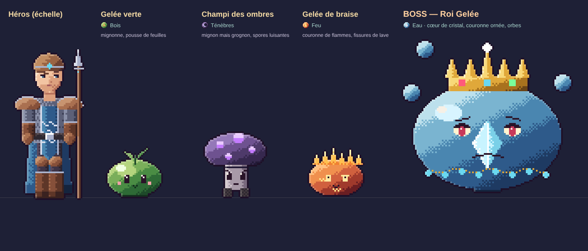

# Pixels Worlds — design des personnages, monstres et éléments

Statut : **maquette v2, en attente de validation**. Rien de ce document n'est encore codé dans le jeu.
Règle de travail : on valide le design ici (maquettes en images), puis un plan d'implémentation, puis seulement le code.

Références : Grow Stone Online (héros et armures), Monster Strike (armures ornementées, éléments, monstres),
en gardant la direction artistique « aquarelle 16 bits » du jeu (palette pastel harmonisée, contours prune, lumière de contour, couleur par zone).

## Décisions validées

| Sujet | Décision |
|---|---|
| Proportions | Héros « héroïques », environ 3,5 têtes (≈ 48 pixels de jeu de haut au lieu de 27), visage adulte |
| Emplacements d'équipement | On ajoute **Épaules** et **Mains** : tête, épaules, torse, mains, jambes, pieds, arme, bijou (8) |
| Ornementation | Elle **monte avec la rareté** : commun sobre → rare liserés et cape → épique plaques sculptées et gemme → légendaire silhouette spectaculaire (ailes, aura) |
| Éléments | **Visuels et gameplay** : Feu, Eau, Bois, Lumière, Ténèbres (proposition de règles ci-dessous, à valider) |
| Monstres | **Petits monstres mignons, boss épiques** |
| Méthode | Maquettes d'abord, validation, puis implémentation |

## Maquettes v2

**Les quatre raretés** (même héros, face et profil, taille réelle sur iPhone en bas) :

- Commun (neutre) : tunique brodée, braies, bâton.
- Rare (Eau) : cotte de mailles, tabard à motif de vagues, liserés argent, épaulières de cuir cerclées, gants, cape, diadème, lance.
- Épique (Feu) : plaques sculptées à flammes dorées, épaulières à deux lames et pointe, gemme de feu, gantelets, tassettes, grèves, cape pourpre, heaume à cimier.
- Légendaire (Lumière) : ivoire et or, filigrane, épaulières à trois lames, heaume ailé, aura, épée lumineuse.

**Corps** : les mêmes pièces s'adaptent à chaque corps (épaules, taille, hanches, jambes) :

**Monstres** :

**Scène en jeu** (vrai décor du jeu, nouveaux personnages à l'échelle ; la villageoise aux cheveux roses est encore dans l'ancien style) :

Le prototype qui génère ces images est dans `prototype/maquette-v2.html` (hors jeu).

## Système de couches (paper doll)

Ordre de dessin, de face : aura → cape → cheveux longs (arrière) → jambes → pieds → corps → torse → tabard → tassettes → ceinture → manches → mains → épaules → tête → cheveux → couvre-chef → arme.
De profil : le bras et la jambe arrière sont assombris et dessinés avant le corps.

Chaque objet définit : **emplacement**, **matériau** (tissu, cuir, mailles, plaques, cristal), **couleur/élément**, **rareté**.
Le matériau fixe la forme et la texture ; l'élément fixe la palette et les motifs (vagues, flammes, feuilles, rayons, pointes) ; la rareté ajoute liserés, gemmes, cape, ailes, aura.

Corps prévus : homme, femme (épaules plus étroites, taille marquée, cheveux longs), carrure large (barbe possible). Peaux et coiffures au choix à la création.

## Éléments — proposition de règles (à valider)

| Élément | Couleur | Motif | Zone / monstres |
|---|---|---|---|
| Feu | braise, or | flammes | Terres sauvages — Gelées de braise |
| Eau | bleu, argent | vagues | Boss Roi Gelée |
| Bois | vert, bronze | feuilles | Prairies de Lumen — Gelées vertes |
| Lumière | ivoire, or | rayons, ailes | Bourg d'Argel (gardiens, PNJ) |
| Ténèbres | violet, argent | pointes, lunes | Bois des Champis — Champis des ombres |

Proposition :
- **Cycle** : Feu bat Bois, Bois bat Eau, Eau bat Feu. Lumière et Ténèbres se battent mutuellement.
- **Avantage** : +30 % de dégâts infligés à un élément faible ; −20 % contre un élément fort.
- **Élément d'attaque** = celui de l'arme. **Résistances** = chaque pièce d'armure d'un élément réduit de 5 % les dégâts de cet élément.
- **Bonus d'ensemble** : 3 pièces du même élément → +10 % de dégâts de cet élément ; 5 pièces → effet visuel (aura colorée).
- **Lisibilité** : icône d'élément sur les objets et au-dessus des monstres, chiffres de dégâts colorés, « Efficace ! » / « Résiste… ».

Questions ouvertes : valeurs exactes, élément des objets existants, éléments des compétences de classe (mage), équilibrage en groupe.

## Ce qui reste brut dans la maquette

Animations (marche, attaque par type d'arme), profils simplifiés, finitions des formes (épaulières légendaires, cimiers), coiffures supplémentaires, PNJ et autres monstres, interface (icônes d'éléments, nouveaux emplacements dans la page personnage).

## Étapes proposées après validation

1. Corps de base et système de couches dans le jeu, avec les objets actuels convertis (aucune perte de sauvegarde : les nouveaux emplacements démarrent vides).
2. Emplacements Épaules et Mains : objets, butin, page personnage.
3. Éléments : données des objets et monstres, règles de combat, affichage.
4. Monstres redessinés, puis boss.
5. Animations et finitions.
