# Pixels Worlds — design des personnages, monstres et éléments

Statut : **personnages en pixel art posé à la main, style Realms of Pixel : validé et intégré au jeu** (`client/sprites.js`).
**Armes sans classes, maîtrise, bouclier (main gauche), points de caractéristiques : codés** (`client/core.js`, `FAMS`).
Pas encore codés : éléments, emplacements Épaules et Mains.

### Ce qui est en jeu (armes v1)

| Famille | Attaque de base | Techniques (maîtrise requise) | Capacités |
|---|---|---|---|
| Épée à une main | Frappe | Tourbillon (2), Taillade (3), Charge (6), Cri de guerre (10) | Port du bouclier (5), Blocage 25 % (8) |
| Arme à deux mains (espadon, hache) | Coup lourd | Moulinet (2), Fendoir (4), Brise-garde (7), Cri de guerre (10) | |
| Dagues | Coups rapides | Saignement (2), Pas de l'ombre (4), Danse des lames (7), Coup dans le dos (11) | |
| Arc | Tir | Volée (2), Flèche perçante (5), Pluie d'Éther (8) | |
| Bâton | Trait d'Éther | Nova de givre (2), Boule de feu (5), Soin lumineux (8) | |
| Lance | Estoc (portée 2) | Balayage (2), Saut (4), Empalement (7) | |

- Maîtrise : +1 par coup porté, +2 + niveau du monstre par victoire (+30 pour le Roi Gelée) ; palier n → n+1 : 10 × n^1,7 points.
- Barre d'actions : 3 cases, choisies dans l'onglet Compétences parmi les techniques débloquées de l'arme en main.
- Caractéristiques : 5 de base partout, +3 points par niveau ; Elya les réinitialise (gratuit une fois, puis 25 PO × niveau).
- Attaque : Force (épées, haches, lances), Agilité (dagues, arc), Intelligence (bâton).
- Bouclier : seulement avec une épée à une main et maîtrise 5 ; il retourne au sac si on prend une autre arme.
- Création : on choisit son arme de départ (épée, arc, bâton, dagues, lance, espadon) au lieu d'une classe.
- Anciennes sauvegardes : le champ `cls` est gardé ; maîtrise de l'ancienne arme = niveau du héros (Archi404 → Épée à une main 8), points répartis selon l'ancienne classe.
Règle de travail : on valide le design ici (maquettes en images), puis un plan d'implémentation, puis seulement le code.

## Personnages en jeu (v7, validés)

Pixel art posé à la main, couches d'équipement recoloriées selon l'objet. Colonnes : face (repos, pas gauche, pas droit, clignement), profil (repos, deux foulées), dos.

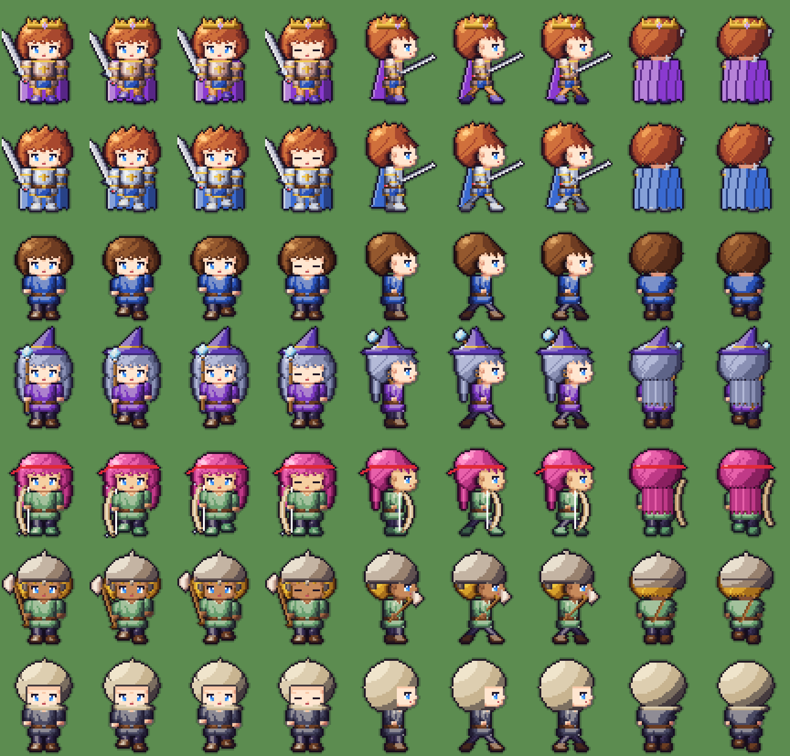

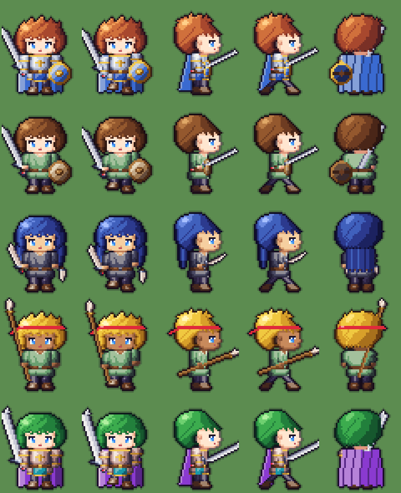

## Direction des personnages : Grow Stone Online (sprites en jeu)

Les maquettes v1 à v3 (héros « héroïques » de 3,5 têtes, style aquarelle puis Monster Strike) sont **abandonnées pour le design
des personnages** : elles partaient d'une mauvaise idée de la référence. La v4 part de **vraies captures** de Grow Stone Online.

Ce qu'on reprend de Grow Stone Online :
- format **compact, environ 2,4 têtes** (≈ 35 pixels de jeu), grosse masse de cheveux ;
- **visages sérieux** : peau claire, petits yeux (1–2 pixels), pas de joues roses ;
- **palette sombre gothique** : noir, marine, violet, rouge sang, or vieilli ;
- **contour quasi noir**, ombrage en 3 tons ;
- **grosses silhouettes** : capuches, chapeaux de sorcière, ailes dans le dos, armes surdimensionnées, capes ;
- **boss menaçants** (silhouette encapuchonnée, ailes, yeux brûlants) ; petits monstres simples et lisibles ;
- le côté flashy vient des **effets de sorts**, pas des vêtements.

Illustrations type Monster Strike / portraits de compagnons : **plus tard** (page personnage, dialogues, intro des boss).

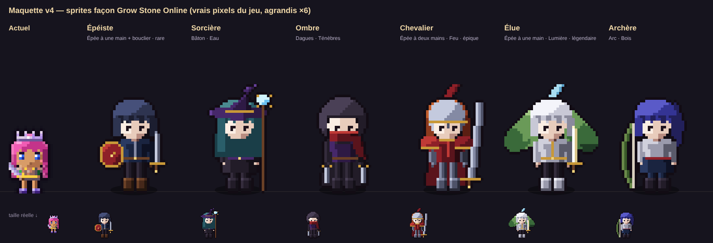

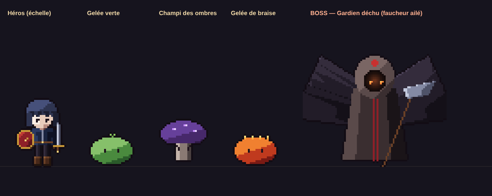

Écarts restants avec la référence : poses de 3/4 vivantes (les maquettes sont de face, raides), variété de corps
(vieux mage voûté, carrures), pixels plus doux avec plis de vêtements.

## Décisions validées

| Sujet | Décision |
|---|---|
| Proportions | ~~3,5 têtes~~ → **compact ≈ 2,4 têtes façon Grow Stone Online** (v4) |
| Emplacements d'équipement | On ajoute **Épaules** et **Mains** : tête, épaules, torse, mains, jambes, pieds, arme, bijou (8) |
| Ornementation | Elle **monte avec la rareté** : commun sobre → rare liserés et cape → épique plaques sculptées et gemme → légendaire silhouette spectaculaire (ailes, aura) |
| Éléments | **Visuels et gameplay** : Feu, Eau, Bois, Lumière, Ténèbres (proposition de règles ci-dessous, à valider) |
| Monstres | **Petits monstres mignons, boss épiques** |
| Méthode | Maquettes d'abord, validation, puis implémentation |
| Classes | **Aucune.** L'arme en main définit les attaques et les sorts ; sa maîtrise débloque ses techniques |
| Maîtrise | Gagnée **en utilisant l'arme** (coups portés, monstres vaincus) |
| Barre d'actions | Attaque de base = celle de l'arme ; **3 techniques au choix** parmi celles débloquées pour cette arme |
| Points de caractéristiques | Donnés à chaque niveau, répartis librement ; **réinitialisation chez un PNJ contre de l'or** |
| Style | **Sprites façon Grow Stone Online** (v4) ; portraits illustrés plus tard |

## Maquettes v2

**Les quatre raretés** (même héros, face et profil, taille réelle sur iPhone en bas) :

- Commun (neutre) : tunique brodée, braies, bâton.
- Rare (Eau) : cotte de mailles, tabard à motif de vagues, liserés argent, épaulières de cuir cerclées, gants, cape, diadème, lance.
- Épique (Feu) : plaques sculptées à flammes dorées, épaulières à deux lames et pointe, gemme de feu, gantelets, tassettes, grèves, cape pourpre, heaume à cimier.
- Légendaire (Lumière) : ivoire et or, filigrane, épaulières à trois lames, heaume ailé, aura, épée lumineuse.

**Corps** : les mêmes pièces s'adaptent à chaque corps (épaules, taille, hanches, jambes) :

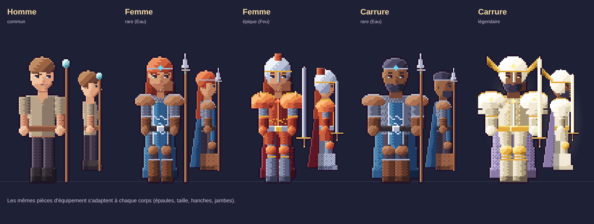

**Monstres** :

**Scène en jeu** (vrai décor du jeu, nouveaux personnages à l'échelle ; la villageoise aux cheveux roses est encore dans l'ancien style) :

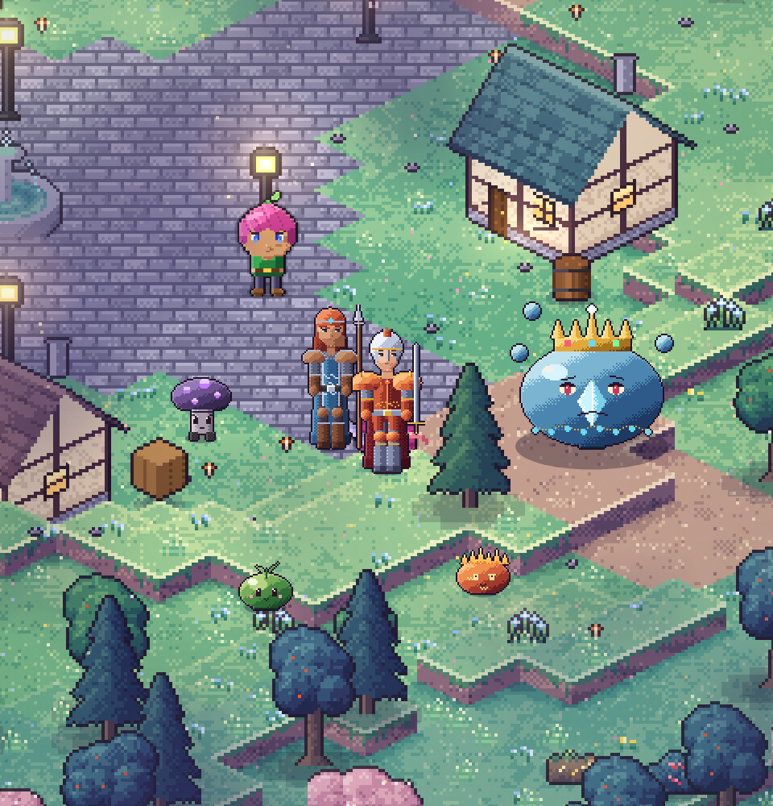

Le prototype qui génère ces images est dans `prototype/maquette-v2.html` (hors jeu).

## Maquette v3 — style Monster Strike / Grow Stone + éthéré

Changements par rapport à la v2 : couleurs saturées, ombrage en aplats francs (3 tons, sans tramage), contour sombre net,
**trait intérieur entre chaque pièce** (épaulières, plastron, gantelets se détachent), yeux d'anime et sourcils marqués,
mèches en pointes avec reflet ; touches éthérées : gemmes qui rayonnent, étincelles flottantes selon la rareté, aura légendaire.

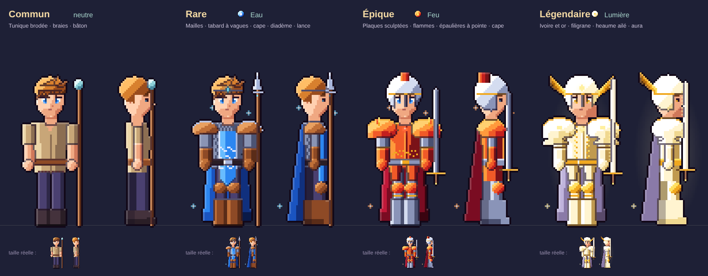

**Les six familles d'armes** (sans classes) :

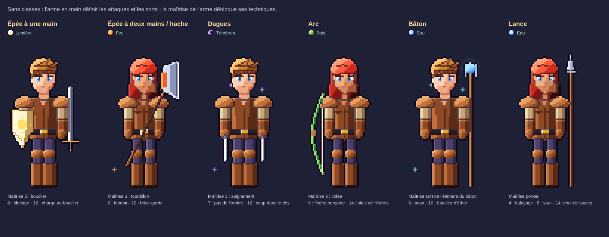

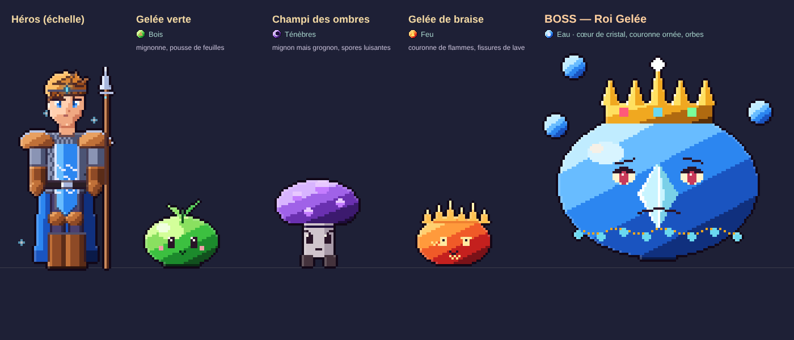

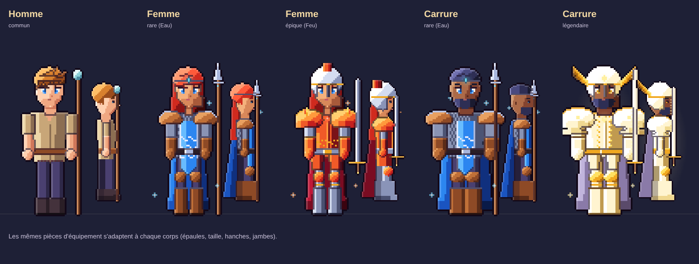

Aperçu du décor avec des couleurs plus franches (moins pastel), personnages v3 à l'échelle :

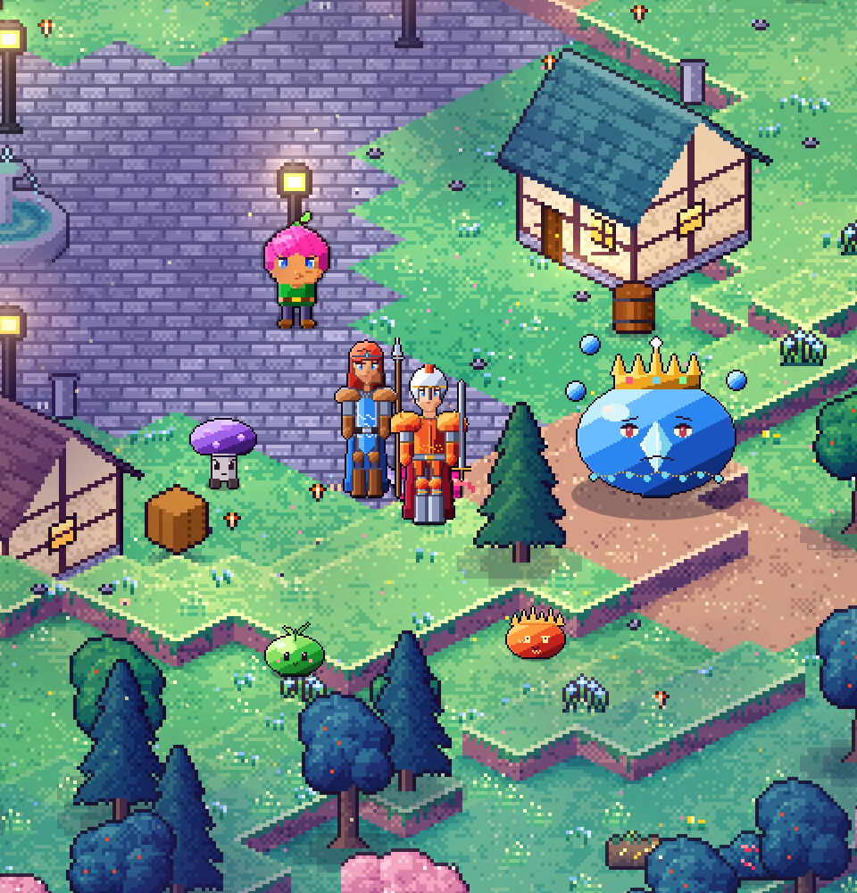

Prototype : `prototype/maquette-v3.html`.

## Progression sans classes (à valider)

**Niveau du personnage** : l'XP donne des niveaux ; chaque niveau donne **3 points** à répartir entre Force, Agilité, Intelligence, Endurance.
Les points sont réinitialisables chez un PNJ du bourg contre de l'or (prix croissant).

| Caractéristique | Effet |
|---|---|
| Force | dégâts des épées, haches, lances |
| Agilité | dégâts des dagues et arcs, critique, vitesse d'attaque |
| Intelligence | dégâts des bâtons et des sorts, mana |
| Endurance | points de vie, efficacité du blocage |

**Maîtrise d'arme** : chaque famille a un niveau de maîtrise de 1 à 20, qui monte en l'utilisant. Elle débloque des **techniques** (actives),
des **passifs** (+dégâts, +critique) et des **capacités** (porter un bouclier, bloquer, manier deux armes).
L'élément de l'arme colore ses techniques (bâton de Feu → boule de feu ; bâton d'Eau → lance d'eau).

| Maîtrise | Épée à une main | Deux mains / hache | Dagues | Arc | Bâton | Lance |
|---|---|---|---|---|---|---|
| 1 | Frappe | Coup lourd | Coups rapides | Tir | Trait de l'élément | Estoc (portée) |
| 3 | Taillade | Tourbillon | Saignement | Volée | Projectile de l'élément | Coup de hampe |
| 5 | **Port du bouclier** | +10 % dégâts | Double maniement amélioré | Recul en tirant | Soin léger | Balayage (4) |
| 8 | **Blocage** | Fendoir | Pas de l'ombre (7) | Flèche perçante (6) | Nova (6) | Saut |
| 12 | Charge au bouclier | Brise-garde (10) | Coup dans le dos | Piège | Bouclier d'éther (10) | Empalement |
| 16 | Riposte | Cri de guerre (14) | Poison | Pluie de flèches (14) | Zone de l'élément | Mur de lances (14) |
| 20 | Lame élémentaire | Rage | Danse des lames | Flèche élémentaire | Météore / déluge / ronces | Tempête de lances |

**Emplacement main gauche** : bouclier (si maîtrise d'épée à une main ≥ 5), dague secondaire, orbe ou carquois selon l'arme.
Total des emplacements : tête, épaules, torse, mains, jambes, pieds, arme, main gauche, bijou.

**Sauvegardes existantes** : les classes disparaissent sans perte. Le niveau est gardé ; les points sont répartis automatiquement
selon l'ancienne classe (réinitialisables gratuitement une fois) ; la maîtrise de l'arme de l'ancienne classe démarre au niveau correspondant
(Archi404, ancien Guerrier niveau 8 → maîtrise Épée à une main 8).

Questions ouvertes : vitesse de gain de maîtrise, nombre de techniques par arme au lancement, armes à deux mains et bouclier incompatibles (oui, par défaut).

## Système de couches (paper doll)

Ordre de dessin, de face : aura → cape → cheveux longs (arrière) → jambes → pieds → corps → torse → tabard → tassettes → ceinture → manches → mains → épaules → tête → cheveux → couvre-chef → arme.
De profil : le bras et la jambe arrière sont assombris et dessinés avant le corps.

Chaque objet définit : **emplacement**, **matériau** (tissu, cuir, mailles, plaques, cristal), **couleur/élément**, **rareté**.
Le matériau fixe la forme et la texture ; l'élément fixe la palette et les motifs (vagues, flammes, feuilles, rayons, pointes) ; la rareté ajoute liserés, gemmes, cape, ailes, aura.

Corps prévus : homme, femme (épaules plus étroites, taille marquée, cheveux longs), carrure large (barbe possible). Peaux et coiffures au choix à la création.

## Éléments — proposition de règles (à valider)

| Élément | Couleur | Motif | Zone / monstres |
|---|---|---|---|
| Feu | braise, or | flammes | Terres sauvages — Gelées de braise |
| Eau | bleu, argent | vagues | Boss Roi Gelée |
| Bois | vert, bronze | feuilles | Prairies de Lumen — Gelées vertes |
| Lumière | ivoire, or | rayons, ailes | Bourg d'Argel (gardiens, PNJ) |
| Ténèbres | violet, argent | pointes, lunes | Bois des Champis — Champis des ombres |

Proposition :
- **Cycle** : Feu bat Bois, Bois bat Eau, Eau bat Feu. Lumière et Ténèbres se battent mutuellement.
- **Avantage** : +30 % de dégâts infligés à un élément faible ; −20 % contre un élément fort.
- **Élément d'attaque** = celui de l'arme. **Résistances** = chaque pièce d'armure d'un élément réduit de 5 % les dégâts de cet élément.
- **Bonus d'ensemble** : 3 pièces du même élément → +10 % de dégâts de cet élément ; 5 pièces → effet visuel (aura colorée).
- **Lisibilité** : icône d'élément sur les objets et au-dessus des monstres, chiffres de dégâts colorés, « Efficace ! » / « Résiste… ».

Questions ouvertes : valeurs exactes, élément des objets existants, éléments des compétences de classe (mage), équilibrage en groupe.

## Ce qui reste brut dans la maquette

Animations (marche, attaque par type d'arme), profils simplifiés, finitions des formes (épaulières légendaires, cimiers), coiffures supplémentaires, PNJ et autres monstres, interface (icônes d'éléments, nouveaux emplacements dans la page personnage).

## Étapes proposées après validation

1. Corps de base et système de couches dans le jeu, avec les objets actuels convertis (aucune perte de sauvegarde : les nouveaux emplacements démarrent vides).
2. Emplacements Épaules et Mains : objets, butin, page personnage.
3. Éléments : données des objets et monstres, règles de combat, affichage.
4. Monstres redessinés, puis boss.
5. Animations et finitions.
