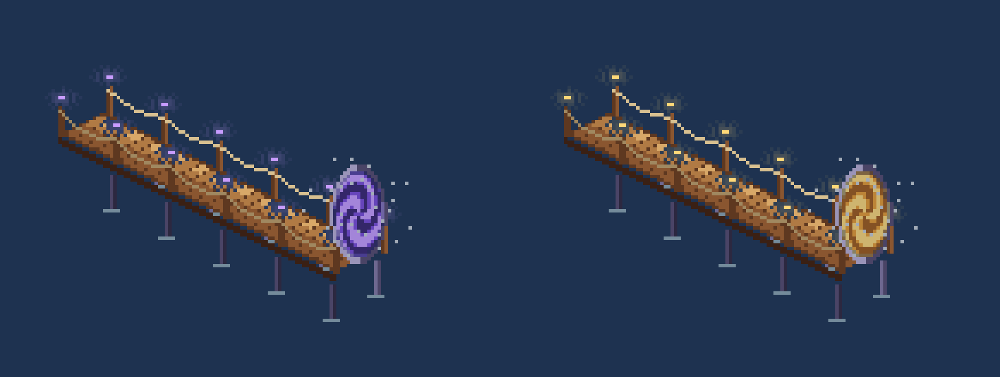

# Pixels Worlds — voyage entre les îles par les ponts

Statut : **validé ; étape 1 codée** (ponts, traversée, tirage, Île Givrée, Île des Braises, îles éphémères avec coffre).
En multijoueur, le serveur fait tourner une simulation par île (les îles éphémères sont libérées 5 minutes après le départ du dernier joueur) ; le tchat des joueurs est commun à toutes les îles.

Choix d'Archibald : îles fixes + parfois une île éphémère ; deux ponts sur chaque île (aléatoire + retour) ;
difficulté adaptée au héros ; maquette avant le code.

## Les deux ponts

- **Pont d'Éther** (lanternes violettes, arche de brume tourbillonnante) : la destination est tirée au hasard **à chaque passage**.
- **Pont du Bourg** (lanternes dorées, arche de lumière chaude) : ramène toujours au Bourg d'Argel.
- Le Bourg d'Argel n'a qu'un Pont d'Éther. Chaque autre île a les deux.

Les ambiances des îles sont ici de simples recolorations de l'île actuelle, pour donner l'idée : en jeu, chaque île aura
ses propres tuiles, arbres, rochers et monstres dessinés.

## Déroulé d'un passage

1. Le héros marche jusqu'à l'arche : « Traverser le Pont d'Éther ? ».
2. Traversée : 1,5 s de fondu dans la brume (couleur du pont), le nom de l'île apparaît (« Île Givrée »).
3. Arrivée sur la tête de pont de l'île tirée. Première visite : « Nouvelle île découverte ! » et l'île s'ajoute au carnet.

Tirage du Pont d'Éther :
- **90 %** : une des îles fixes, jamais celle où l'on se trouve ;
- **10 %** : une **île éphémère** générée à partir d'une graine aléatoire, avec un coffre au butin rare.
  Elle disparaît dès qu'on la quitte (on ne peut pas y revenir).

## Îles fixes (proposition)

| Île | Ambiance | Monstres (petits, mignons) | Ressource |
|---|---|---|---|
| Île Givrée | neige, sapins givrés, lac gelé | gelées de givre, pingouins-boules | cristal de givre |
| Île des Braises | cendre, roches noires, coulées de lave | gelées de braise, salamandres | pierre de braise |
| Île aux Champignons | champignons géants, spores lumineuses | champis, escargots | spore |
| Île Céleste | ruines flottantes, nuages, vent | petits golems, oiseaux | plume d'éther |
| Lagon de Corail | sable blanc, palmiers, coraux | crabes, gelées d'eau | perle |
| Marais englouti | ruines dans l'eau, brume verte | grenouilles, lucioles | roseau |

Au lancement : **2 îles** (Givrée et Braises) + les îles éphémères, puis les autres une par une.

## Règles

- **Difficulté** : les monstres d'une île prennent le niveau du héros qui arrive (±1). En groupe, celui du membre le plus haut.
- **Groupe** : les joueurs qui traversent ensemble (moins de 10 s d'écart) atterrissent sur la même île.
- **Sauvegarde** : nouveau champ `isle` (île actuelle, et graine si éphémère) et `isles` (îles découvertes).
  À la reconnexion, on revient sur l'île où l'on était.
- **Multijoueur** : le serveur fait tourner une simulation par île, créée à la demande et libérée quand elle est vide ;
  chaque île éphémère est une instance privée (le joueur ou son groupe).

## Décisions

- Le Pont d'Éther **coûte 3 Éther** (gagné en marchant dans la vraie vie) ; le Pont du Bourg est gratuit et ramène à la fontaine.
- **Île Givrée** : chaque coup ralentit l'ennemi 2,5 s. **Île des Braises** : chaque coup l'enflamme 3 s (12 % des dégâts par seconde).
  Les créatures du même élément y sont insensibles (gelées de givre sur la Givrée, gelées de braise sur les Braises) ;
  ces îles mêlent donc créatures natives et monstres venus d'ailleurs.
- Pour changer d'île, le jeu sauvegarde puis recharge la nouvelle île derrière un fondu de brume (pas de perte possible).

## Ce qui est en jeu (étape 1)

- `core.js` : `ISLES`, `buildIsle`, `findBridge` (pont posé sur une rive basse), `rollIsle`, messages `cross` et `chest`,
  champs de sauvegarde `isle`, `isles`, `arr` ; monstres au niveau du héros ; effets `slow` / `burn`.
- `assets.js` : palettes de terrain par île, sapins et chênes givrés, gelée de givre, planches de pont, arches animées, coffre.
- `client/game/` (anciennement `game.js`) : île lue dans la sauvegarde au démarrage, poteaux à lanternes et arches dans le décor, invites
  « Traverser » / « Rentrer » / « Ouvrir le coffre », fondu de traversée, reprise automatique sur la nouvelle île.

## Étapes après validation

1. Ponts (dessin, traversée, tirage), sauvegarde de l'île, Île Givrée et Île des Braises, îles éphémères.
2. Nouveaux monstres et ressources de ces deux îles.
3. Les quatre autres îles, une par une.
4. Instances d'îles sur le serveur multijoueur.

## Danger sur les îles (codé)

- **Combat entre joueurs** autorisé sur toutes les îles du voyage ; le Bourg d'Argel reste un refuge.
  Les noms des autres joueurs y sont rouges, avec leur barre de vie ; l'attaque vise la cible la plus proche (monstre ou joueur).
- **Mort sur une île** : tout le contenu du sac (hors objets uniques) reste sur le corps pendant 3 minutes ;
  n'importe qui peut le piller (« Piller le corps de … »), y compris le mort s'il revient à temps. L'équipement porté n'est jamais perdu.
  On réapparaît au bout du Pont d'Éther de l'île.
- Code : `Sim.pvp`, `foe()`, `hurt(p, dmg, src)` (source monstre ou joueur), `die()`, `corpses`, message `loot` ; serveur : `isles` (une `Sim` par île).

## Accessibilité (garantie à la génération)

Sur chaque île, l'arrivée (bout du Pont d'Éther) et le Pont du Bourg sont choisis ensemble : le Pont du Bourg doit être
atteignable à pied depuis l'arrivée (relief franchissable, pas d'obstacle), un chemin dégagé est réservé entre les deux
(aucun arbre ni rocher), et monstres, cueillette et coffre ne sont placés que sur des cases accessibles.
Vérifié sur l'Île Givrée, l'Île des Braises et 1 000 îles éphémères tirées au hasard.
Mini-carte : Pont d'Éther en violet, Pont du Bourg en doré.
