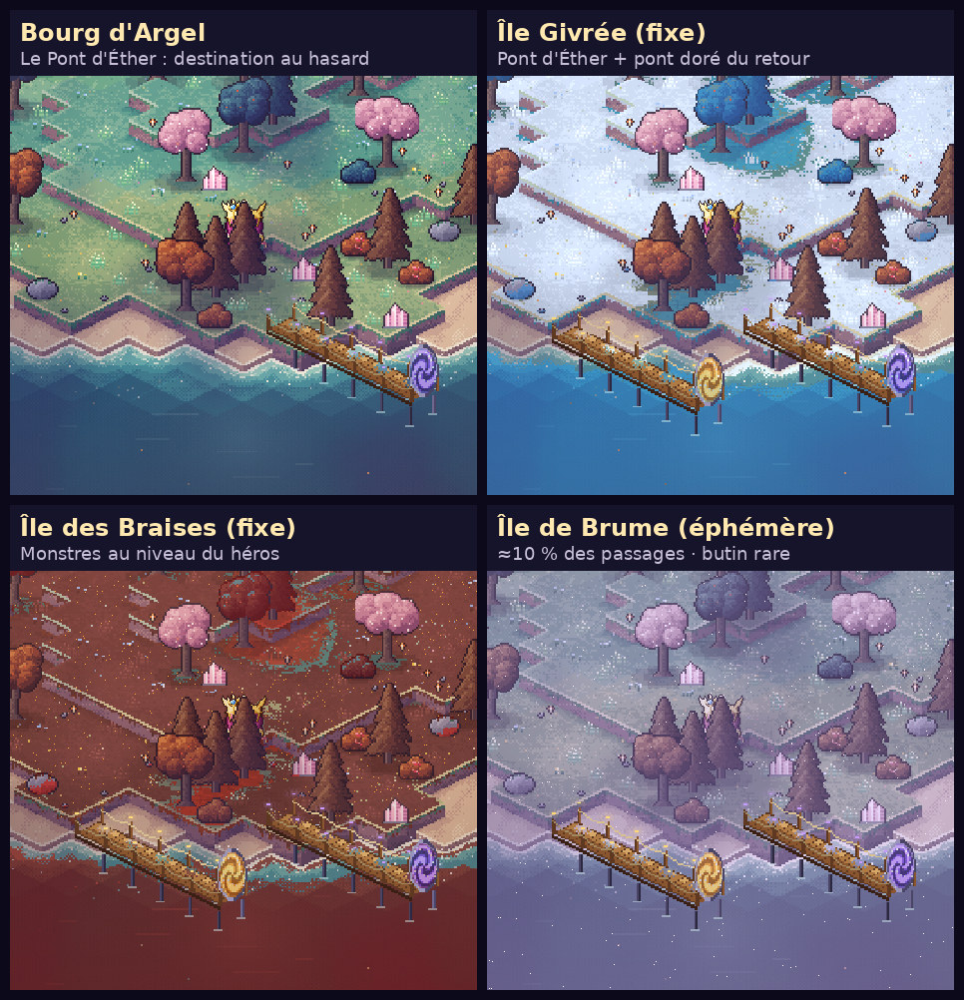

# Pixels Worlds — voyage entre les îles par les ponts

Statut : **maquette, en attente de validation**. Rien n'est codé.

Choix d'Archibald : îles fixes + parfois une île éphémère ; deux ponts sur chaque île (aléatoire + retour) ;
difficulté adaptée au héros ; maquette avant le code.

## Les deux ponts

- **Pont d'Éther** (lanternes violettes, arche de brume tourbillonnante) : la destination est tirée au hasard **à chaque passage**.
- **Pont du Bourg** (lanternes dorées, arche de lumière chaude) : ramène toujours au Bourg d'Argel.
- Le Bourg d'Argel n'a qu'un Pont d'Éther. Chaque autre île a les deux.

Les ambiances des îles sont ici de simples recolorations de l'île actuelle, pour donner l'idée : en jeu, chaque île aura
ses propres tuiles, arbres, rochers et monstres dessinés.

## Déroulé d'un passage

1. Le héros marche jusqu'à l'arche : « Traverser le Pont d'Éther ? ».
2. Traversée : 1,5 s de fondu dans la brume (couleur du pont), le nom de l'île apparaît (« Île Givrée »).
3. Arrivée sur la tête de pont de l'île tirée. Première visite : « Nouvelle île découverte ! » et l'île s'ajoute au carnet.

Tirage du Pont d'Éther :
- **90 %** : une des îles fixes, jamais celle où l'on se trouve ;
- **10 %** : une **île éphémère** générée à partir d'une graine aléatoire, avec un coffre au butin rare.
  Elle disparaît dès qu'on la quitte (on ne peut pas y revenir).

## Îles fixes (proposition)

| Île | Ambiance | Monstres (petits, mignons) | Ressource |
|---|---|---|---|
| Île Givrée | neige, sapins givrés, lac gelé | gelées de givre, pingouins-boules | cristal de givre |
| Île des Braises | cendre, roches noires, coulées de lave | gelées de braise, salamandres | pierre de braise |
| Île aux Champignons | champignons géants, spores lumineuses | champis, escargots | spore |
| Île Céleste | ruines flottantes, nuages, vent | petits golems, oiseaux | plume d'éther |
| Lagon de Corail | sable blanc, palmiers, coraux | crabes, gelées d'eau | perle |
| Marais englouti | ruines dans l'eau, brume verte | grenouilles, lucioles | roseau |

Au lancement : **2 îles** (Givrée et Braises) + les îles éphémères, puis les autres une par une.

## Règles

- **Difficulté** : les monstres d'une île prennent le niveau du héros qui arrive (±1). En groupe, celui du membre le plus haut.
- **Groupe** : les joueurs qui traversent ensemble (moins de 10 s d'écart) atterrissent sur la même île.
- **Sauvegarde** : nouveau champ `isle` (île actuelle, et graine si éphémère) et `isles` (îles découvertes).
  À la reconnexion, on revient sur l'île où l'on était.
- **Multijoueur** : le serveur fait tourner une simulation par île, créée à la demande et libérée quand elle est vide ;
  chaque île éphémère est une instance privée (le joueur ou son groupe).

## Question ouverte

Le Pont d'Éther pourrait **coûter de l'Éther** (par exemple 3, gagné en marchant dans la vraie vie) : la marche réelle
deviendrait le carburant de l'exploration. Le Pont du Bourg resterait gratuit.

## Étapes après validation

1. Ponts (dessin, traversée, tirage), sauvegarde de l'île, Île Givrée et Île des Braises, îles éphémères.
2. Nouveaux monstres et ressources de ces deux îles.
3. Les quatre autres îles, une par une.
4. Instances d'îles sur le serveur multijoueur.
